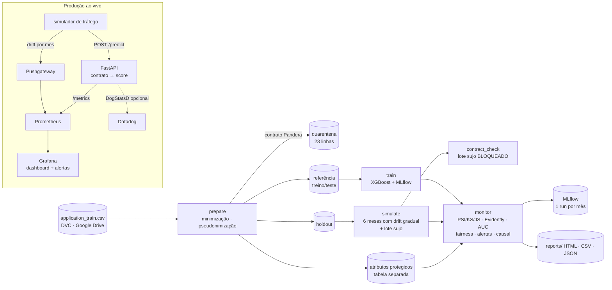
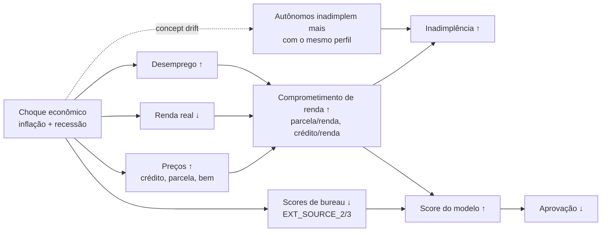

# Credit Guard — sustentação de um modelo de Credit Scoring em produção

Camada de **sustentação e confiabilidade** para um modelo de concessão de crédito: contratos de
dados que barram dado ruim, simulação e detecção de degradação silenciosa (data drift e concept
drift), observabilidade do pipeline e do modelo, e governança de dados sob a LGPD com análise
causal da degradação.

> Tech Challenge — Fase 4 · Pós-Tech Machine Learning Engineering (FIAP)
> Tema: Observabilidade Contínua, Detecção de Drift, Qualidade de Dados e Governança em Produção

| | |
|---|---|
| 🎥 **Vídeo (STAR, ≤ 5 min)** | _link a ser adicionado_ |
| 📊 **Relatório de drift (Evidently)** | [`reports/drift/reference_vs_month_06.html`](reports/drift/reference_vs_month_06.html) |
| 🛑 **Contrato bloqueando o lote sujo** | [`reports/validation/dirty_batch.html`](reports/validation/dirty_batch.html) |
| 📈 **Resumo mês a mês** | [`reports/monitoring/summary.csv`](reports/monitoring/summary.csv) |

> Os relatórios `.html` não são renderizados pelo GitHub: baixe o arquivo (botão *Download raw*)
> e abra no navegador.

---

## Sumário

1. [Contexto e problema](#1-contexto-e-problema)
2. [Arquitetura](#2-arquitetura)
3. [Como executar](#3-como-executar)
4. [Etapa 1 — Contrato de dados](#4-etapa-1--contrato-de-dados)
5. [Modelo baseline](#5-modelo-baseline)
6. [Etapa 2 — Simulação e detecção de drift](#6-etapa-2--simulação-e-detecção-de-drift)
7. [Etapa 3 — Observabilidade](#7-etapa-3--observabilidade)
8. [Runbooks dos alertas](#8-runbooks-dos-alertas)
9. [Etapa 4 — Governança e LGPD](#9-etapa-4--governança-e-lgpd)
10. [Análise causal da degradação](#10-análise-causal-da-degradação)
11. [Lições aprendidas](#11-lições-aprendidas)
12. [Estrutura do repositório](#12-estrutura-do-repositório)

---

## 1. Contexto e problema

Uma fintech de crédito tem um modelo de *credit scoring* em produção. Com inflação e novos perfis
de clientes, a diretoria suspeita de **degradação silenciosa**: o modelo continua respondendo, sem
erros, mas suas decisões pioram. Em software tradicional um bug derruba o sistema; em ML o sistema
segue "saudável" enquanto aprova quem não devia e recusa quem devia.

Este projeto constrói a camada que torna essa degradação **visível, explicável e acionável**:

- **interceptar dados ruins** antes que cheguem ao modelo (contratos de dados);
- **detectar mudanças de distribuição** e queda de performance (PSI, KS, JS, Evidently);
- **dar visibilidade operacional** (logs estruturados, métricas, dashboards e alertas);
- **garantir compliance** (LGPD, base legal, retenção, viés) e **explicar a causa**.

**Dataset:** [Home Credit Default Risk](https://www.kaggle.com/competitions/home-credit-default-risk)
(Kaggle), tabela `application_train.csv`: **307.511 clientes**, inadimplência de **8,07%**.

**Stack:** Python 3.11 · uv · scikit-learn + XGBoost · **Pandera** (contratos) · **Evidently AI**
0.7 (drift) · SciPy (PSI/KS/JS/Qui-quadrado) · **MLflow** 3 (experimentos e monitoramento) ·
FastAPI · **Prometheus** + Pushgateway + **Grafana** · **Datadog** (opcional, DogStatsD) ·
**DVC** com remote no Google Drive · Docker Compose · GitHub Actions.

---

## 2. Arquitetura



- O **pipeline DVC** (`dvc.yaml`: `prepare → train → simulate → contract_check → monitor`) é a
  fonte da verdade, reproduzível com `dvc repro`, e gera todos os relatórios versionados em `reports/`.
- A **API + simulador de tráfego** reproduzem a produção ao vivo para o dashboard: o simulador envia
  os meses em sequência para a API e publica no Pushgateway as métricas de drift de cada mês.
- **Um único contrato de dados** valida tudo que entra: o arquivo bruto, os lotes batch e cada
  requisição da API, sempre **antes** da engenharia de features.

---

## 3. Como executar

Pré-requisitos: Python 3.11, [uv](https://docs.astral.sh/uv/) e Docker.

```bash
# 1. dependências
uv sync

# 2. dados e modelo versionados (Google Drive público via DVC)
uv run dvc pull
```

> **Alternativa se o `dvc pull` falhar** (o Google às vezes bloqueia o app OAuth padrão do DVC):
> baixe `application_train.csv` do [Kaggle](https://www.kaggle.com/competitions/home-credit-default-risk/data),
> coloque em `data/raw/application_train.csv` e rode `uv run dvc repro` (regera tudo, ~3 min).

```bash
# 3. (opcional) reproduzir o pipeline inteiro
uv run dvc repro

# 4. ver o contrato BLOQUEANDO o lote sujo (exit code 1)
uv run python -m credit_guard.contracts.ingest \
  --input data/dirty/dirty_batch.parquet --report-dir reports/validation --name dirty_batch

# 5. subir a "produção": API + Prometheus + Pushgateway + Grafana
docker compose up -d --build

# 6. simular 6 meses de tráfego (o dashboard atualiza ao vivo)
uv run python -m credit_guard.simulation.traffic --pause-seconds 20

# 7. MLflow (experimentos de treino e runs de monitoramento por mês)
uv run mlflow ui --backend-store-uri sqlite:///mlflow.db --port 5000
```

| Serviço | URL |
|---|---|
| API (Swagger) | http://localhost:8000/docs |
| Grafana (dashboard *Credit Guard*) | http://localhost:3000 (anônimo; admin/admin) |
| Prometheus (alertas) | http://localhost:9090/alerts |
| MLflow | http://localhost:5000 |

**Datadog (opcional):** copie `.env.example` para `.env`, preencha `DD_API_KEY` e `DD_ENABLED=true`,
e suba com `docker compose --profile datadog up -d`. As mesmas métricas passam a ser espelhadas via
DogStatsD. Sem a chave, nada muda: o Datadog nunca é dependência.

**Testes:** `uv run pytest` (82 testes, dados 100% sintéticos, sem depender do dataset) ·
**Lint:** `uv run ruff check .` · A CI (GitHub Actions) roda lint → testes com cobertura → build da imagem.

---

## 4. Etapa 1 — Contrato de dados

**Foco: lixo não entra no modelo.** O contrato (`src/credit_guard/contracts/schema.py`) é escrito
em **Pandera** e aplicado no formato de entrada, em todos os pontos de ingestão. A validação é
*lazy* (coleta todas as violações) e *fail-fast* no efeito: qualquer violação **bloqueia o lote**
(exit code 1 no batch, HTTP 422 na API) e gera relatório JSON + HTML.

### Regras (17 checagens rígidas, bem acima das 3 exigidas)

| Regra (nome estável) | Dimensão de qualidade | O que garante |
|---|---|---|
| `required_not_null` | Completude | renda, crédito, parcela, idade, emprego, nº de membros e categóricas nunca nulos |
| `age_between_18_100` | Validade | idade (de `DAYS_BIRTH`) entre 18 e 100 anos |
| `income_positive_max` | Validade | 0 < renda ≤ 5.000.000 |
| `unique_client_id` | Unicidade | sem clientes duplicados no lote |
| `domain_<coluna>` (7 colunas) | Validade | categorias dentro do domínio conhecido (tipo de contrato, renda, escolaridade, estado civil, carro, imóvel, rating da região) |
| `annuity_le_credit` | Consistência | parcela ≤ valor do crédito |
| `ext_source_unit_interval` | Validade | scores de bureau `EXT_SOURCE_*` em [0, 1] |
| `days_employed_non_positive` | Validade | dias de emprego ≤ 0 (ou o sentinela) |
| `employment_sentinel_consistency` | Consistência | `DAYS_EMPLOYED = 365243` **só** para aposentados/desempregados |
| `children_range`, `fam_members_min` | Validade | 0–20 filhos; ≥ 1 membro na família |
| `domain_CODE_GENDER` (ingestão batch) | Validade | gênero ∈ {F, M} — só no contrato batch; a API nunca recebe gênero |

**A regra do sentinela é o melhor exemplo de contrato orientado ao negócio.** No dataset, 55.374
clientes têm `DAYS_EMPLOYED = 365243` ("mil anos empregado"). Não é lixo: verificamos que aparece
**exclusivamente** em 55.352 aposentados e 22 desempregados, ou seja, é a codificação de "não
empregado". O contrato aceita o sentinela nesses casos e o rejeita em qualquer outro (ex.: um
`Working` com 365243 é erro de integração).

### Evidências

| Lote | Veredito | Linhas | Inválidas | Violações por regra |
|---|---|---:|---:|---|
| Bruto (`reference_raw`) | quarentena | 307.511 | **23** | `required_not_null` 14 · `income_positive_max` 5 (inclui renda de **117 milhões**) · `domain_CODE_GENDER` 4 (`XNA`) · `domain_NAME_FAMILY_STATUS` 2 (`Unknown`) |
| Lote sujo (`dirty_batch`) | **BLOQUEADO** | 500 | **500** | `unique_client_id` 136 · `required_not_null` 83 · `annuity_le_credit` 69 · `employment_sentinel_consistency` 69 · `domain_NAME_CONTRACT_TYPE` 69 · `age_between_18_100` 69 · `ext_source_unit_interval` 68 · `income_positive_max` 5 · `domain_NAME_FAMILY_STATUS` 2 |
| Produção mês 1 (`month_01`) | **APROVADO** | 10.000 | 0 | — |

O lote sujo mistura **19 linhas de sujeira real** do Home Credit (da quarentena) com 7 tipos de
defeito injetado (renda nula, menor de idade, parcela > crédito, `Working` com sentinela, tipo de
contrato `Leasing`, `EXT_SOURCE_3 = 1,7`, IDs duplicados). Relatórios:
[`dirty_batch.html`](reports/validation/dirty_batch.html) ·
[`reference_raw.html`](reports/validation/reference_raw.html) ·
[`month_01.html`](reports/validation/month_01.html).

Na API, o mesmo contrato devolve `422` com as regras violadas:

```json
{"detail": {"error": "contract_violation",
            "violations_by_check": {"required_not_null": 1},
            "violations": [{"row_index": 0, "column": "AMT_INCOME_TOTAL", "check": "required_not_null", "failure_case": null}]}}
```

Campos extras (ex.: tentar enviar `CODE_GENDER`) ou ausentes também são recusados com 422 e
contabilizados em `credit_contract_rejections_total{check="schema_shape"}`.

---

## 5. Modelo baseline

XGBoost em pipeline scikit-learn (engenharia de features → one-hot → classificador), treinado na
**referência** (60% dos dados limpos, estratificado). O **threshold de negócio** aprova 80% dos
clientes da referência (PD < 0,120). Tudo registrado no **MLflow** (`credit-training`) e no
*Model Registry* como `credit-scoring` v1.

| Métrica (referência, 15% de teste) | Valor |
|---|---:|
| ROC-AUC | **0,764** |
| Gini | 0,528 |
| KS | 0,394 |
| PR-AUC | 0,243 |
| Taxa de aprovação | 80,0% |
| Inadimplência entre aprovados | 4,8% (vs. 8,1% na base) |

Features: 19 colunas de entrada + 7 derivadas (idade em anos, anos de emprego, flag "não empregado",
crédito/renda, parcela/renda, prazo implícito, bem/crédito). As mais importantes:
`NAME_EDUCATION_TYPE`, `EXT_SOURCE_2`, `EXT_SOURCE_3`, `NAME_INCOME_TYPE`, `NAME_FAMILY_STATUS`
([`feature_importance.csv`](reports/model/feature_importance.csv)).

**Por que idade entra e gênero não:** idade é um fator de risco de crédito legítimo e usual
(estabilidade de renda, histórico), e sua exclusão não eliminaria o efeito (ela é inferível por
tempo de emprego e de documento). Gênero não tem justificativa de negócio para precificar risco e
seu uso direto seria discriminatório: **fica fora do modelo e da API**, mantido apenas em tabela
separada para auditoria de fairness. Ver [seção 9](#9-etapa-4--governança-e-lgpd).

---

## 6. Etapa 2 — Simulação e detecção de drift

### Separação referência × produção

- **Referência:** treino (60%) + teste (15%) dos dados limpos. É o "mundo" que o modelo conhece.
- **Produção:** 6 meses de 10.000 clientes cada, amostrados de um **holdout (25%) nunca visto no
  treino**, sem sobreposição entre meses. É onde o drift acontece.

### A história econômica simulada (gradual, `params.yaml`)

| Mês | Preços (crédito, parcela, bem) | Renda real | Working → Unemployed | Scores de bureau | Concept drift (P de virar mau pagador no segmento) | Inadimplência real |
|---:|---:|---:|---:|---:|---:|---:|
| 1 | +5% | −3% | 3% | −0,02 | — | 8,1% |
| 2 | +10% | −6% | 6% | −0,04 | — | 7,8% |
| 3 | +15% | −9% | 9% | −0,06 | — | 7,9% |
| 4 | +20% | −12% | 12% | −0,08 | 5% | 8,9% |
| 5 | +25% | −15% | 15% | −0,10 | 10% | 10,4% |
| 6 | +30% | −18% | 18% | −0,12 | 15% | 11,6% |

- **Data drift (covariate shift)** em 4 grupos de variáveis importantes: inflação, erosão da renda
  real, desemprego e piora de bureau. O choque é **heterogêneo por cliente** (cada um sofre uma
  fração aleatória do choque médio), como na economia real.
- **Concept drift:** a partir do mês 4, clientes `Commercial associate` (autônomos, os mais expostos
  à crise) passam a inadimplir mais **com as mesmas features**: muda P(inadimplência | X), não X.
  Só é detectável quando os rótulos chegam (rótulos atrasados), pela queda de performance.

### Detecção

Para cada mês, o estágio `monitor` compara produção × referência com **testes próprios**
(`src/credit_guard/monitoring/stats.py`, para transparência) e com o **Evidently AI**:

- **PSI** por feature (faixas da indústria de crédito: < 0,10 estável · 0,10–0,20 investigar ·
  ≥ 0,20 retreinar), **KS** (p-valor < 0,05), **Jensen-Shannon** e **Qui-quadrado** para categóricas;
- **Evidently** `DataDriftPreset` + `DataSummaryPreset` por mês e, no relatório final,
  `ClassificationPreset` (performance com rótulos);
- **performance** (AUC, KS, taxa de aprovação) e **fairness** por mês; cada mês vira um run no MLflow.

> **PSI robusto a pontos de massa.** A renda do Home Credit é muito repetida (135.000 = 12% dos
> clientes). Com bordas de quantil sobre esses valores, uma variação de 1% movia a massa inteira de
> bin e inflava o PSI. As bordas foram deslocadas para não cair sobre pontos de massa
> (teste `test_psi_robust_to_mass_points_with_near_duplicates`).

### Resultado: degradação mês a mês ([`summary.csv`](reports/monitoring/summary.csv))

| Mês | AUC | KS | Aprovação | Features em drift (PSI ≥ 0,20) | Alertas |
|---:|---:|---:|---:|---:|---|
| ref | **0,764** | 0,394 | 80,0% | — | — |
| 1 | 0,777 | 0,426 | 78,6% | 0 | — |
| 2 | 0,774 | 0,418 | 75,8% | 0 | FairnessDisparateImpact |
| 3 | 0,748 | 0,366 | 72,6% | 3 | FeatureDriftCritical · ApprovalRateShift · Fairness |
| 4 | 0,723 | 0,343 | 68,7% | 5 | + **ModelAucDrop** |
| 5 | 0,698 | 0,294 | 66,3% | 7 | idem |
| 6 | **0,672** | 0,263 | 61,9% | **9** | + DriftedShareHigh (todos os 5 de modelo) |

PSI das variáveis mais afetadas:

| Feature | Mês 1 | Mês 3 | Mês 6 |
|---|---:|---:|---:|
| `EXT_SOURCE_2` | 0,02 | 0,29 | **1,38** |
| `EXT_SOURCE_3` | 0,01 | 0,11 | **0,76** |
| `annuity_income_ratio` | 0,02 | 0,21 | **0,71** |
| `NAME_INCOME_TYPE` | 0,08 | 0,29 | **0,65** |
| `credit_income_ratio` | 0,02 | 0,12 | **0,44** |
| `AMT_INCOME_TOTAL` | 0,14 | 0,13 | **0,28** |

O Evidently confirma, no mês 6, **9 das 24 features em drift** (37,5%): `AMT_INCOME_TOTAL`,
`AMT_CREDIT`, `AMT_ANNUITY`, `AMT_GOODS_PRICE`, `EXT_SOURCE_2`, `EXT_SOURCE_3`,
`credit_income_ratio`, `annuity_income_ratio`, `NAME_INCOME_TYPE`
([relatório completo](reports/drift/reference_vs_month_06.html) · relatórios mensais em
`reports/monitoring/month_XX/drift_report.html`).

**Leitura:** o data drift aparece cedo (mês 3) e já tira 1,6 p.p. de AUC; quando o concept drift
entra (mês 4), a AUC despenca 4,1 p.p. abaixo da referência e o alerta crítico dispara. No mês 6 o
modelo perdeu **9,2 p.p. de AUC** e a inadimplência real subiu de 8,1% para 11,6% — exatamente a
degradação silenciosa que a diretoria suspeitava: nenhuma requisição falhou.

---

## 7. Etapa 3 — Observabilidade

Três pilares, cada um com uma ferramenta:

- **Logs estruturados (JSON)** em todos os estágios e na API (`ts`, `level`, `logger`, `event` +
  contexto), sem PII: eventos como `stage_started`, `stage_succeeded`/`stage_failed`,
  `ingestion_blocked`, `contract_rejected`, `prediction_served`, `month_monitored`.
- **Métricas** Prometheus: a API expõe `/metrics`; os estágios batch e o simulador publicam no
  Pushgateway. Opcionalmente, tudo é espelhado no **Datadog** via DogStatsD.
- **Rastreamento** no **MLflow**: experimento `credit-training` (parâmetros, métricas, assinatura,
  modelo registrado) e `credit-monitoring` (**um run por mês** com PSI por feature, AUC, aprovação,
  DI, nº de alertas e os relatórios como artefatos), formando a série temporal auditável da degradação.

O dashboard **Credit Guard** no Grafana (provisionado em `grafana/dashboards/`) segue uma hierarquia:
saúde operacional → saúde do modelo → drift, com um seletor de mês.

### Métricas de saúde escolhidas

| Métrica | Tipo | O que mede | SLO / limiar | Alerta |
|---|---|---|---|---|
| `credit_requests_total{path,status_code}` | counter | volume e taxa de erro da API | — | — |
| `credit_request_latency_seconds` | histogram | latência do `/predict` | **p95 < 500 ms** (medido: ~93 ms) | `ApiLatencyHigh` |
| `credit_contract_rejections_total{check}` | counter | linhas barradas pelo contrato, por regra | **< 1% das linhas** | `ContractRejectionHigh` |
| `credit_rows_scored_total` | counter | volume de dados processados | — | — |
| `credit_predictions_total{decision}` / `credit_score` | counter / histogram | decisões e distribuição do score servido | — | — |
| `credit_pipeline_stage_status{stage}` | gauge | status do estágio (1 ok, 0 falhou) | 100% de sucesso | `PipelineStageFailed` |
| `credit_pipeline_stage_duration_seconds{stage}` | gauge | duração de cada estágio | — | — |
| `credit_pipeline_rows{stage,outcome}` | gauge | linhas aceitas / bloqueadas / geradas por estágio | — | — |
| `credit_drift_psi{feature,month}` | gauge | PSI por feature e mês | **PSI < 0,20** nas top-5 | `FeatureDriftCritical` |
| `credit_drift_share{month}` | gauge | fração de features em drift | < 30% | `DriftedShareHigh` |
| `credit_model_auc{month}` | gauge | AUC com rótulos atrasados | queda < 3 p.p. | `ModelAucDrop` |
| `credit_approval_rate{month}` | gauge | taxa de aprovação | desvio < 5 p.p. | `ApprovalRateShift` |
| `credit_fairness_di{attribute,month}` | gauge | disparate impact por gênero e faixa etária | DI ≥ 0,8 | `FairnessDisparateImpact` |
| `credit_alerts_active{alert}` | gauge | estado atual de cada alerta de modelo | — | — |

As regras de alerta estão em [`prometheus/alerts.yml`](prometheus/alerts.yml), com os **mesmos
nomes** de `credit_guard.monitoring.alerts` e um `runbook_url` para a seção abaixo.

---

## 8. Runbooks dos alertas

<a id="runbook-feature-drift-critical"></a>
### FeatureDriftCritical (crítico)
**Significa:** uma das 5 features mais importantes do modelo tem PSI ≥ 0,20 contra a referência.
**Investigar:** abrir o `drift_report.html` do mês e o painel *PSI por feature*; checar se é mudança
real da população (economia, nova campanha, novo canal) ou quebra de integração (unidade, encoding).
**Ação:** se for quebra → corrigir a origem e reprocessar; se for mudança real → avaliar retreino com
dados recentes e acompanhar `ModelAucDrop` quando os rótulos chegarem.

<a id="runbook-drifted-share-high"></a>
### DriftedShareHigh (aviso)
**Significa:** 30% ou mais das features estão em drift significativo — a população mudou como um todo.
**Investigar:** comparar com eventos externos (macroeconomia, política comercial); rodar a análise causal.
**Ação:** planejar retreino; considerar ajustar o threshold de aprovação enquanto isso.

<a id="runbook-model-auc-drop"></a>
### ModelAucDrop (crítico)
**Significa:** com os rótulos já observados, a AUC caiu ≥ 3 p.p. vs. a referência — o modelo está
discriminando pior (típico de **concept drift**).
**Investigar:** AUC por segmento (tipo de renda, produto); se as features não driftaram mas a AUC
caiu, a relação X → inadimplência mudou.
**Ação:** retreinar com a janela recente (champion/challenger antes de promover no MLflow); regra de
negócio temporária para o segmento afetado.

<a id="runbook-approval-rate-shift"></a>
### ApprovalRateShift (aviso)
**Significa:** a taxa de aprovação desviou ≥ 5 p.p. da referência (80%).
**Investigar:** é efeito do drift (população mais arriscada) ou de mudança no score? Cruzar com
`credit_score` e com a inadimplência dos aprovados.
**Ação:** validar com a área de crédito se o novo nível é desejado; recalibrar o threshold se não for.

<a id="runbook-contract-rejection-high"></a>
### ContractRejectionHigh (crítico)
**Significa:** mais de 1% das linhas recebidas está sendo barrada pelo contrato.
**Investigar:** painel *Rejeições do contrato por regra* e o log `contract_rejected` (regra, lote);
falha concentrada numa regra indica mudança no sistema produtor.
**Ação:** acionar o time produtor; manter o bloqueio (circuit breaker) — nunca afrouxar o contrato
para "fazer passar".

<a id="runbook-fairness-disparate-impact"></a>
### FairnessDisparateImpact (aviso)
**Significa:** o disparate impact de gênero ou de faixa etária está abaixo de 0,8 **e piorou** ≥ 0,05
em relação à referência (o viés já conhecido da referência é tratado na governança, não realertado).
**Investigar:** tabela `fairness.csv` do mês: aprovação, inadimplência e TPR por grupo.
**Ação:** acionar o comitê de risco/ética e o encarregado (DPO); avaliar mitigação (seção 9.6).

<a id="runbook-api-latency-high"></a>
### ApiLatencyHigh (aviso)
**Significa:** latência p95 do `/predict` acima de 500 ms por mais de 1 minuto.
**Investigar:** tamanho dos lotes, CPU/memória do container, volume de requisições.
**Ação:** escalar réplicas horizontalmente; limitar o tamanho do lote por requisição.

<a id="runbook-pipeline-stage-failed"></a>
### PipelineStageFailed (crítico)
**Significa:** um estágio do pipeline terminou com exceção (`credit_pipeline_stage_status == 0`).
**Investigar:** log `stage_failed` (estágio, erro, duração, linhas).
**Ação:** corrigir e reexecutar com `dvc repro <estágio>`; o modelo em produção não é substituído
enquanto o pipeline não estiver verde.

---

## 9. Etapa 4 — Governança e LGPD

### 9.1 Inventário de dados e tratamento de PII

O arquivo bruto tem 122 colunas; **o pipeline lê apenas 22** (minimização, LGPD art. 6º, III).

| Campo | Categoria | Tratamento |
|---|---|---|
| `SK_ID_CURR` | identificador direto | **pseudonimizado** no primeiro estágio: `client_id = sha256(salt + id)[:16]`; o ID original nunca sai do `prepare` |
| `CODE_GENDER` | dado pessoal protegido (não discriminação) | **fora do modelo e da API**; guardado em tabela separada (`data/protected/`) só para auditoria de fairness |
| `DAYS_BIRTH` (idade) | dado pessoal | feature do modelo (justificada na seção 5); faixa etária derivada só para auditoria |
| renda, crédito, parcela, preço do bem | dado pessoal financeiro | usado no modelo; nunca escrito em logs |
| estado civil, filhos, família, escolaridade, tipo de renda, emprego, bens | dado pessoal | usado no modelo; nunca escrito em logs |
| `EXT_SOURCE_1/2/3` | scores de bureau | usado no modelo |
| demais 100 colunas (endereço, telefone, documentos, imóvel...) | — | **não coletadas** pelo pipeline |

Nenhum dado pessoal sensível do art. 5º, II (origem racial, saúde, religião, biometria etc.) é
tratado. **Controles técnicos:** dados brutos e derivados nunca vão para o git (DVC + `.gitignore`);
o salt da pseudonimização vem de variável de ambiente (em produção, de um cofre de segredos); logs e
o log de predições registram só o `client_id` pseudonimizado, a decisão e o score — **nenhum valor
de feature**; a API recusa (`422`) qualquer campo fora do contrato, inclusive atributos protegidos.

### 9.2 Base legal

- **Art. 7º, X — proteção do crédito:** base legal principal para a análise de risco e a decisão
  de crédito.
- **Art. 7º, V — procedimentos preliminares a contrato** a pedido do titular (a solicitação de crédito).
- **Art. 20 — revisão de decisões automatizadas:** o titular pode pedir revisão da decisão. O
  processo prevê revisão por analista humano, e o modelo é explicável (importância de features e a
  atribuição por cliente pode ser obtida com a mesma técnica de intervenção da seção 10). O §1º
  (informar critérios e procedimentos) é atendido pela documentação do modelo (`MODEL_CARD.md`).
- **Princípios do art. 6º:** finalidade (só risco de crédito), adequação, necessidade (minimização),
  transparência, segurança, prevenção e **não discriminação** (gênero fora do modelo, auditoria de
  fairness contínua).

### 9.3 Privacy by Design e by Default (7 princípios aplicados)

| Princípio | Como aparece no projeto |
|---|---|
| Proativo, não reativo | contrato e auditoria de fairness rodam em todo lote, antes de qualquer incidente |
| Privacidade como padrão | API não aceita atributos protegidos; logs sem PII por construção |
| Privacidade embutida no design | pseudonimização e minimização no primeiro estágio do pipeline |
| Funcionalidade total (soma positiva) | o modelo atinge AUC 0,764 sem gênero e sem 100 colunas desnecessárias |
| Segurança ponta a ponta | dados fora do git, segredos fora do código (`.env`, `.dvc/config.local`), container não-root |
| Visibilidade e transparência | relatórios versionados, MLflow auditável, model card, este README |
| Respeito ao titular | revisão humana (art. 20), retenção limitada, eliminação ao fim do prazo |

### 9.4 Plano de retenção

| Dado | Onde | Prazo | Descarte |
|---|---|---|---|
| Bruto (`application_train.csv`) | DVC / Drive | enquanto o modelo vigente depender dele, no máximo 5 anos após o fim da relação | exclusão do remote e do cache DVC |
| Referência e holdout pseudonimizados | DVC | vida útil do modelo + 5 anos (auditoria e reprodutibilidade) | exclusão |
| Tabela de atributos protegidos | DVC, acesso restrito | mesmo prazo da referência; uso exclusivo para fairness | exclusão |
| Log de predições (`client_id`, score, decisão) | `logs/` | 5 anos (comprovação da decisão, art. 20; registros de operações financeiras) | anonimização (remoção do `client_id`) e agregação |
| Logs operacionais JSON | stack de logs | 90 dias | expiração automática |
| Métricas Prometheus/Datadog | TSDB | 15 dias (Prometheus) / plano do Datadog | expiração automática |
| Modelos e runs do MLflow | MLflow | vida útil + 5 anos | arquivamento e exclusão |

O prazo de 5 anos segue a guarda de registros de operações financeiras (ex.: Lei 9.613/1998,
art. 10) e o art. 16, I da LGPD (conservação para cumprimento de obrigação legal/regulatória).
Pedidos de eliminação do titular (art. 18, VI) são atendidos pelo `client_id` em todas as tabelas,
ressalvadas as obrigações legais de guarda.

### 9.5 Papéis e RIPD resumido

- **Controlador:** a fintech · **Operador:** provedores de nuvem e de observabilidade (ex.: Datadog,
  que recebe só métricas agregadas, sem dados pessoais) · **Encarregado (DPO):** canal do titular e
  ponto de contato com a ANPD (art. 41).
- **RIPD (art. 38) — riscos e mitigações:**

| Risco | Probabilidade × impacto | Mitigação implementada |
|---|---|---|
| Reidentificação a partir dos dados de treino | baixa × alto | pseudonimização com salt, minimização, dados fora do git |
| Discriminação por gênero/idade na decisão | média × alto | gênero fora do modelo; auditoria de DI por gênero e faixa etária todo mês; alerta de piora |
| Decisões erradas por degradação silenciosa | alta × alto | contrato + monitoramento de drift + alertas com runbooks |
| Vazamento por logs/observabilidade | média × médio | logs sem valores de feature; métricas agregadas; Datadog opcional sem PII |
| Uso fora da finalidade | baixa × alto | finalidade única documentada; tabela protegida isolada |

### 9.6 Mitigação de vieses — achado real

A auditoria de fairness (`monitoring/fairness.py`) mede, por grupo, taxa de aprovação,
inadimplência e **TPR** (aprovação entre bons pagadores — igualdade de oportunidade), e o
**disparate impact** (DI = menor aprovação ÷ maior aprovação; regra dos 80%: DI ≥ 0,8).

| | Referência | Mês 6 |
|---|---:|---:|
| DI por gênero (F × M) | **0,913** ✅ | 0,858 ✅ |
| DI por faixa etária | **0,649** ⚠️ | 0,486 ⚠️ |
| Aprovação < 25 anos / 55+ | 60,1% / 92,5% | 37,7% / 77,5% |

- **Gênero passa** na regra dos 80% mesmo sem estar no modelo, e se mantém no drift.
- **Idade não passa — já na referência.** O modelo aprova 60% dos clientes com menos de 25 anos e
  92,5% dos com 55+. Parte é risco real (a inadimplência na referência é 12,8% vs. 5,2%), mas o
  TPR também é desigual (64,5% vs. 93,6%): **bons pagadores jovens são recusados mais vezes**.
- **O drift piora o viés:** no mês 6 o DI etário cai para 0,486. A crise atinge mais os jovens, e o
  alerta `FairnessDisparateImpact` dispara a partir do mês 2.

**Plano de mitigação:** (1) levar o achado ao comitê de risco e ao DPO antes de qualquer retreino;
(2) avaliar reponderação ou restrição de igualdade de oportunidade (TPR) por faixa etária no
retreino; (3) thresholds revisados por segmento com justificativa documentada, se aprovados;
(4) revisão humana obrigatória para recusas na faixa < 25 anos com score próximo do threshold;
(5) manter a auditoria mensal e o alerta de piora.

---

## 10. Análise causal da degradação



**O que é covariate shift e o que é concept drift.** Os quatro choques mudam as **features** (X):
são detectados pelo PSI/Evidently já no mês 3, sem precisar de rótulos. O efeito sobre os
autônomos muda a **relação** X → inadimplência: as features desse grupo não mudam, então nenhum
teste de distribuição o vê; ele aparece só na queda da AUC quando os rótulos chegam (mês 4+).

**Atribuição empírica (intervenção).** Para cada choque do grafo, desfazemos o choque inteiro nos
dados do mês 6 (cada variável recebe o valor da referência no mesmo quantil, mantendo o resto
igual), re-pontuamos e medimos quanto do aumento do score médio some
([`attribution_shocks_month_06.md`](reports/causal/attribution_shocks_month_06.md)):

| Choque (nó do grafo) | Parcela do deslocamento do score | Aprovação recuperada |
|---|---:|---:|
| Piora de bureau (`EXT_SOURCE_2/3`) | **90,3%** | +16,1 p.p. |
| Inflação (crédito, parcela, preço do bem) | 8,5% | +1,2 p.p. |
| Desemprego (tipo de renda + emprego) | 7,3% | +1,4 p.p. |
| Erosão da renda real | 4,6% | +0,7 p.p. |

(As parcelas somam ~111% por interação entre os choques.) A intervenção é feita **por choque, não
por variável**: desfazer só o preço do bem, mantendo o crédito inflacionado, cria clientes
incoerentes — essa versão ingênua atribui −88% ao preço do bem
([`attribution_month_06.md`](reports/causal/attribution_month_06.md)), um artefato que a
intervenção conjunta elimina.

**Conclusão prescritiva.** O score do modelo reage quase só à piora de bureau; os choques de
**capacidade de pagamento** (renda, inflação, desemprego) quase não movem o score, embora sejam os
que elevam a inadimplência real. Somado ao concept drift nos autônomos, isso explica a perda de
9,2 p.p. de AUC. Ações: (1) **retreinar** com a janela recente (meses 4–6, rótulos já disponíveis),
reforçando as razões de comprometimento de renda; (2) até lá, **regra de negócio temporária** para
autônomos (limite de comprometimento de renda ou revisão manual); (3) **recalibrar o threshold**
para a meta de inadimplência dos aprovados, não para a taxa de aprovação; (4) incluir indicadores
macro (inflação, desemprego) como contexto do monitoramento para antecipar o próximo ciclo.

---

## 11. Lições aprendidas

- **"Sem erro" não é "saudável".** A API respondeu 100% das requisições válidas enquanto o modelo
  perdia 9 p.p. de AUC; só o monitoramento de dados e de performance revela isso.
- **Conheça o dado antes de escrever a regra.** O sentinela 365243 parecia lixo, mas era uma
  codificação legítima; uma regra ingênua teria rejeitado 18% dos clientes (todos os aposentados).
- **Testes de drift têm armadilhas.** Dados com muitos valores repetidos inflam o PSI; em amostras
  grandes o KS acusa tudo como significativo. Por isso o PSI (magnitude) decide e o KS (significância)
  complementa.
- **Data drift não é concept drift.** O concept drift não aparece em nenhum teste de distribuição;
  monitorar só as features teria deixado passar a parte mais grave da degradação.
- **Fairness também deriva.** O viés etário existia na referência e piorou com a crise; o alerta
  compara com a referência para não virar ruído.
- **Causalidade exige intervir no nó certo.** Variáveis que se movem juntas devem ser desfeitas juntas.

---

## 12. Estrutura do repositório

```
src/credit_guard/
  contracts/      schema.py (contrato Pandera) · validation.py · report.py · ingest.py (porta de ingestão)
  data/           prepare.py (minimização, pseudonimização, quarentena, splits)
  model/          features.py · train.py (MLflow) · metrics.py (AUC/Gini/KS) · scoring.py
  simulation/     drift.py (data + concept drift) · dirty.py (lote sujo) · simulate.py · traffic.py
  monitoring/     stats.py (PSI/KS/JS/χ²) · evidently_reports.py · fairness.py · alerts.py · causal.py · monitor.py
  observability/  pipeline.py (track_stage) · publish.py (Pushgateway + Datadog)
  api/            main.py (FastAPI) · schemas.py · metrics.py (Prometheus)
reports/          relatórios versionados (validação, modelo, simulação, monitoramento, drift, causal)
prometheus/       scrape + regras de alerta       grafana/   datasource + dashboard provisionados
dvc.yaml · params.yaml · docker-compose.yml · Dockerfile · .github/workflows/ci.yml · MODEL_CARD.md
```
